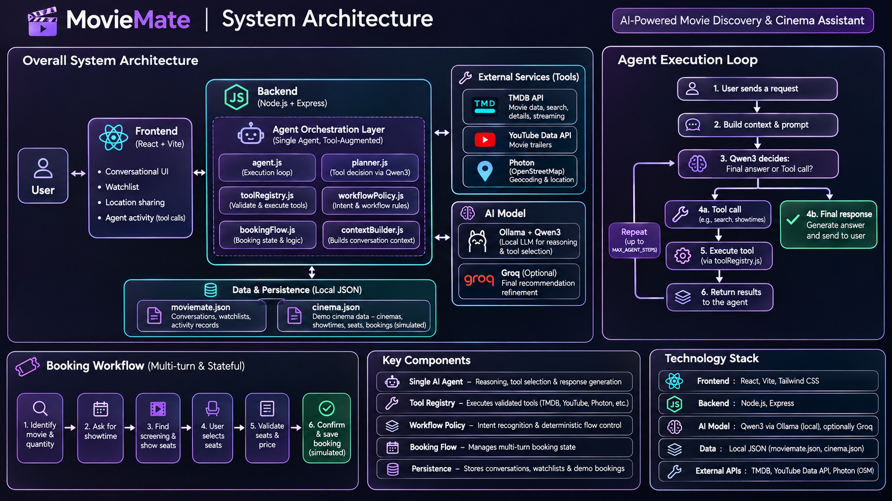

# MovieMate — AI Movie Discovery & Cinema Assistant

<p align="center">
  
</p>

<p align="center">
  <strong>A conversational movie assistant powered by a local LLM, tool calling, external movie data and stateful demo cinema workflows.</strong>
</p>

<p align="center">
  
  
  
  
  
</p>

> **Project status:** Local development / demonstration project. Movie metadata is retrieved from TMDB. Cinema schedules, seat inventory and bookings are simulated local data. No real ticket is issued and no payment is processed.

## Contents

- [Overview](#overview)
- [What MovieMate can do](#what-moviemate-can-do)
- [Architecture](#architecture)
- [How the agent works](#how-the-agent-works)
- [Booking workflow](#booking-workflow)
- [Technology stack](#technology-stack)
- [Project structure](#project-structure)
- [Getting started](#getting-started)
- [Environment variables](#environment-variables)
- [Running tests](#running-tests)
- [API endpoints](#api-endpoints)
- [Demo prompts](#demo-prompts)
- [Data, privacy and security](#data-privacy-and-security)
- [Limitations and next steps](#limitations-and-next-steps)
- [Acknowledgements](#acknowledgements)

## Overview

MovieMate is an AI-powered movie discovery and cinema assistant. Users interact with it through a conversational React interface and can express requests in natural language rather than navigating separate search forms.

The backend uses a **single-agent, tool-augmented architecture with deterministic workflow orchestration**. A locally hosted Qwen3 model, served through Ollama, can choose from application-defined tools. The Express backend validates and executes those tools, returns their results to the agent, and streams progress and the final response to the frontend.

MovieMate combines:

- LLM-based planning and tool selection.
- Deterministic intent parsing and workflow rules for important application flows.
- External APIs for movie metadata, trailers and geocoding.
- Local JSON persistence for conversations, watchlists, activity records and demo cinema data.
- Multi-turn booking state so a user can provide a movie, time, ticket quantity and seat choices across separate messages.

## What MovieMate can do

| Capability | Description | Data / execution source |
|---|---|---|
| Movie discovery | Search and recommend movies using natural-language requests and constraints such as genre, rating, year and result count. | TMDB + local intent/workflow logic |
| Movie details | Retrieve movie metadata and details. | TMDB |
| Trailer discovery | Find a trailer through YouTube search. | YouTube Data API when configured; otherwise a YouTube search-link fallback |
| Streaming availability | Look up regional streaming-provider information where TMDB has data. | TMDB / selected region |
| Cinema discovery | Find supported demo cinemas and search demo screenings by movie, genre, date, time, location and ticket-price constraints. | Local `cinema.json` dataset |
| Location-aware search | Use browser-shared coordinates and Photon reverse geocoding to resolve a supported metro/locality. | Browser Geolocation + Photon / OpenStreetMap |
| Seat availability | Inspect seat categories and availability for a demo screening. | Local `cinema.json` dataset |
| Simulated booking | Select a screening, seats and category, review the total and confirm a demo booking. | Local `cinema.json` dataset |
| Booking changes | Change supported booking details before confirmation, pause a pending booking to explore another request, and resume it. | Conversation workflow state |
| Cancellation | Select a confirmed demo booking and explicitly confirm its cancellation. | Local `cinema.json` dataset |
| Watchlist | Add, list and remove saved movies. | Local `moviemate.json` store |
| Conversation continuity | Reload recent messages and continue a conversation using its conversation ID. | Local `moviemate.json` store |
| Agent activity | Display workflow activity and execution timings in the frontend. | Express Server-Sent Events (SSE) + local activity records |

**Language handling:** a phrase such as “preferably in English” is not treated as a hard language filter or ranking preference in the current fresh-discovery flow. Matching results are not reordered just because English was mentioned.

## Architecture

<p align="center">
  
</p>

### Main components

| Component | Responsibility |
|---|---|
| React + Vite | Chat interface, watchlist, location-sharing interaction, activity panel and streamed response rendering. |
| Express server | HTTP routes, request handling, health checks and SSE streaming. |
| `agent.js` | Coordinates the agent run, workflow state, planner calls, tool execution and final response. |
| `planner.js` | Sends the conversation and available tool definitions to Ollama and interprets the model's next action. |
| `toolRegistry.js` | Exposes tool schemas, checks whether a tool is allowed for the current workflow and dispatches the tool implementation. |
| `workflowPolicy.js` + `intentCorpus.js` | Deterministic intent recognition, constraint extraction and workflow-routing rules. |
| `bookingFlow.js` | Booking-specific parsing and selection helpers, including ticket counts, show selection and seat labels. |
| `contextBuilder.js` + `systemPrompt.js` | Prepare relevant context/evidence and define model behaviour. |
| Tool implementations | Perform movie, trailer, streaming, location, cinema, seat, booking and watchlist operations. |
| JSON persistence | Stores local conversations, messages, watchlists, agent executions, tool logs, activity events and demo cinema data. |

### How the agent works

<p align="center">
  
</p>

1. The user sends a message from the React chat interface.
2. The Express route identifies the conversation and starts an agent execution.
3. The backend loads recent conversation history and relevant workflow state.
4. Deterministic workflow logic identifies the request type and handles application-specific constraints or pending stages.
5. The planner sends the model the conversation context and the tools available for that workflow.
6. Qwen3 can return a tool call. The registry checks that the tool is available and executes its implementation.
7. The tool result is added to the agent context. The model can then make another tool call or produce a final response.
8. The agent loop is bounded by `MAX_AGENT_STEPS` to limit repeated tool calls.
9. The backend streams status/activity events and the final response to React using Server-Sent Events.

**Important distinction:** the LLM proposes a tool call; the application executes it. The tool registry is not the planner, and MovieMate is not a multi-agent system. It is one primary agent supported by tools and deterministic workflow code.

### Optional Groq refinement

Ollama with Qwen3 remains the primary agent. If Groq is configured, MovieMate may make one optional final refinement request for eligible complex movie recommendations after the local agent has gathered movie evidence. Groq does not run the tool loop or execute booking operations. If Groq is unavailable or not configured, the Ollama answer is used.

## Booking workflow

<p align="center">
  
</p>

A typical multi-turn flow looks like this:

1. User: “Book two tickets for [movie title].”
2. MovieMate preserves the requested title and ticket quantity and asks for a showtime if one is missing.
3. User supplies a time or chooses a screening from the matching results.
4. MovieMate checks the demo seat map and offers available seat categories/options.
5. User chooses seats; MovieMate validates them and calculates the total.
6. MovieMate displays a booking summary and requires explicit confirmation.
7. After confirmation, the demo booking is written to `server/data/cinema.json`.

The user can also modify supported booking details before confirmation, or pause a pending booking to explore another movie and return to it. Cancellation requires selecting a confirmed demo booking and explicitly confirming the cancellation.

> **This is not a real ticketing integration.** Cinema schedules and seat availability are generated demo data. Booking and cancellation only modify the local demo dataset. No payment gateway is connected, no real ticket is issued and no refund is processed.

## Technology stack

| Layer | Technology | Usage |
|---|---|---|
| Frontend | React 18, Vite 6 | Single-page chat application |
| UI icons | Lucide React | Interface icons |
| Backend | Node.js, Express 4 | API and agent runtime |
| LLM runtime | Ollama | Local model serving |
| Primary model | Qwen3 (default `qwen3:8b`) | Reasoning and tool selection |
| Optional model API | Groq | Final recommendation refinement for eligible requests |
| Movie data | TMDB API | Movie search, details and streaming-provider metadata |
| Trailer search | YouTube Data API (optional) | Trailer lookup; search-link fallback without a key |
| Geocoding | Photon / OpenStreetMap | Reverse geocoding of shared browser coordinates |
| Persistence | Local JSON files | Conversation and demo data storage |
| Streaming | Server-Sent Events | Agent activity and chat response streaming |
| Tests | Node.js built-in test runner | Intent, workflow, booking, cinema and model-routing tests |

## Project structure

```text
MovieMate/
├── client/
│   └── src/
│       ├── components/          # Chat, messages, watchlist and activity UI
│       ├── services/            # Frontend API client and SSE reader
│       ├── App.jsx
│       └── styles.css
│
├── server/
│   ├── agent/
│   │   ├── agent.js             # Main agent orchestration loop
│   │   ├── planner.js           # Ollama planning / tool-call handoff
│   │   ├── toolRegistry.js      # Tool schemas and execution dispatch
│   │   ├── workflowPolicy.js    # Intent and workflow rules
│   │   ├── intentCorpus.js      # Rule-based intent patterns
│   │   ├── bookingFlow.js       # Booking parsing and selection helpers
│   │   ├── contextBuilder.js    # Compact context and Groq evidence
│   │   └── systemPrompt.js      # Model instructions
│   │
│   ├── tools/                   # Movie, trailer, cinema, seat, booking tools
│   ├── cinema/                  # Schedule, location, time and price logic
│   ├── services/                # Ollama, Groq and TMDB integrations
│   ├── routes/                  # Chat, movie and activity endpoints
│   ├── database/                # Local JSON persistence layer
│   ├── data/
│   │   └── cinema.json          # Synthetic demo cinema catalogue
│   ├── tests/                   # Automated Node.js tests
│   ├── config/
│   ├── server.js
│   └── .env.example
│
├── docs/
│   └── images/                  # Architecture and workflow diagrams
├── README.md
├── package.json
└── .gitignore
```

## Getting started

### Prerequisites

- Node.js 20 or newer.
- npm.
- [Ollama](https://ollama.com/download) installed and running.
- A Qwen3 model available in Ollama (default: `qwen3:8b`).
- A TMDB API key for movie search and details.
- Optional YouTube Data API key for API-backed trailer lookup.
- Optional Groq API key for final recommendation refinement.

### 1. Clone the repository

```bash
git clone https://github.com/YOUR_USERNAME/MovieMate-AI.git
cd MovieMate-AI
```

Replace the URL with the repository URL you publish.

### 2. Install dependencies

From the project root:

```bash
npm install
npm install --prefix server
npm install --prefix client
```

### 3. Install and start Ollama

Install Ollama, then pull the default model:

```bash
ollama pull qwen3:8b
```

Make sure Ollama is running and the model is available:

```bash
ollama list
```

### 4. Configure environment variables

Copy the example file:

```bash
# macOS / Linux
cp server/.env.example server/.env

# Windows PowerShell
Copy-Item server/.env.example server/.env
```

Open `server/.env` and add your own TMDB key. Add YouTube and Groq keys only if you want those optional integrations.

### 5. Start the application

From the project root:

```bash
npm run dev
```

- Frontend: <http://localhost:5173>
- Backend: <http://localhost:5000>
- Health check: <http://localhost:5000/api/health>

The root `dev` script starts the Express server and Vite development server together.

### 6. Optional: run each part separately

```bash
# Terminal 1 — backend
npm run dev --prefix server

# Terminal 2 — frontend
npm run dev --prefix client
```

## Environment variables

The backend reads its environment from `server/.env`.

| Variable | Required? | Default / purpose |
|---|---|---|
| `PORT` | No | `5000` — Express port |
| `CLIENT_ORIGIN` | No | `http://localhost:5173` — allowed frontend origin for CORS |
| `OLLAMA_URL` | Yes for local LLM | `http://localhost:11434` — Ollama base URL |
| `OLLAMA_MODEL` | No | `qwen3:8b` — local model name |
| `TMDB_API_KEY` | Yes for TMDB features | TMDB API key |
| `TMDB_REGION` | No | `IN` — region for provider lookup |
| `YOUTUBE_API_KEY` | No | YouTube Data API key; fallback search URL is used when absent |
| `GROQ_API_KEY` | No | Enables optional Groq final refinement |
| `GROQ_MODEL` | No | `llama-3.3-70b-versatile` — configurable Groq model |
| `GROQ_TIMEOUT_MS` | No | `25000` — Groq request timeout |
| `GROQ_MAX_OUTPUT_TOKENS` | No | `450` — Groq output limit |
| `MAX_AGENT_STEPS` | No | `5` — maximum local agent planning/tool steps |
| `MAX_LOCAL_TOOL_CHARS` | No | `40000` — local tool-result character budget |

The frontend API base defaults to `http://localhost:5000/api`. For a different backend URL, configure the Vite variable `VITE_API_URL` at frontend build/dev time, including the `/api` suffix, for example:

```env
VITE_API_URL=https://your-backend.example.com/api
```

**Never commit `server/.env`, API keys, private conversation data or real credentials.** The `.env.example` file contains placeholders only.

## Running tests

From the server directory:

```bash
npm test
```

The included automated tests cover intent routing, multi-intent parsing, movie-title matching, booking conversations, seat selection, cinema schedules, time parsing, location resolution, price filters and model routing.

**Latest local verification for this repository snapshot:** `66` tests passed, `0` failed using `node --test` in `server/`.

These are automated unit/regression tests. They do not replace a live end-to-end test against Ollama, TMDB, YouTube or browser geolocation.

## API endpoints

| Method | Endpoint | Purpose |
|---|---|---|
| `GET` | `/api/health` | Backend, Ollama, TMDB configuration and local storage health |
| `GET` | `/api/chat/conversation/:id` | Load saved conversation messages |
| `POST` | `/api/chat/stream` | Submit a chat request and receive agent events/final response over SSE |
| `GET` | `/api/movies/watchlist` | Retrieve the local watchlist |
| `DELETE` | `/api/movies/watchlist/:id` | Remove an item from the watchlist |
| `GET` | `/api/activity?limit=25` | Retrieve recent activity events |
| `GET` | `/api/activity/stream` | Stream new activity events over SSE |

## Demo prompts

Use these prompts to explore the main workflows. Exact results depend on the current TMDB response, available API credentials, supported demo locations and local cinema dataset.

### Movie discovery

- `Recommend a mystery movie with a strong rating.`
- `Find three sci-fi thrillers released after 2020.`
- `Show me details and the trailer for Interstellar.`
- `Where can I stream this movie in India?`

### Cinema discovery

- `Find thriller screenings under ₹250 in Bengaluru.`
- `Find a movie near me after 8 PM.`
- `Show cinemas near me.`
- `Find screenings for Ramayana around 7 PM.`

### Booking simulation

- `Book two tickets for Ramayana.`
- `Change that to three tickets.`
- `Show available seats.`
- `Use the suggested seats.`
- `Confirm booking.`
- `Show my bookings.`
- `Cancel my booking.`

### Conversation continuity

- Start a booking and provide its movie/time/seat details over separate messages.
- Pause a pending booking to ask for another movie recommendation.
- Ask to resume the pending booking.
- Start a new discovery request after a cinema result list rather than selecting an old result.

For an employer walkthrough, demonstrate a small number of complete scenarios rather than rapidly entering many unrelated prompts. Make it clear when a cinema or booking result comes from the simulated dataset.

## Data, privacy and security

### Local data files

| File | Purpose | Git behaviour |
|---|---|---|
| `server/data/cinema.json` | Seeded demo cities, theatres, movies, screenings, seat categories and demo bookings. | Included so the demo can run with sample data. |
| `server/data/moviemate.json` | Local conversations, messages, watchlist, agent execution records, tool logs and activity events. | Ignored by Git because it may contain personal conversation data. Created on first backend startup. |
| `server/.env` | API keys and local configuration. | Ignored by Git. |
| `server/.env.example` | Placeholder environment template. | Safe to commit after confirming it contains no secrets. |

The JSON store is intended for local, single-user development/demo use. It is not a concurrent multi-user production database. Back up `server/data/moviemate.json` if you want to preserve local chat history and watchlists.

### Location

The browser only shares coordinates after the user grants permission. The backend reverse-geocodes shared coordinates using the public Photon / OpenStreetMap service. If location permission is denied, users can enter a city or locality manually. Geolocation requires HTTPS in a deployed environment (localhost is allowed for local development).

### Before making the repository public

- Confirm `server/.env` is not tracked: `git status --short` and `git check-ignore server/.env`.
- Do not commit `server/data/moviemate.json` or personal chat exports.
- Keep `server/data/cinema.json` only as synthetic test data.
- Rotate any API key that was ever committed accidentally; deleting it from the latest commit is not sufficient.
- Review TMDB and YouTube API terms, quotas and attribution requirements before public/commercial use.
- Add a licence only if you have the rights and intend to grant reuse.

## Limitations and next steps

### Current limitations

- Ollama must be reachable by the backend and the selected model must support the tool-calling behaviour expected by the planner.
- TMDB requires internet access and a valid API key. Data availability depends on TMDB coverage and its terms.
- Trailer API lookup is optional. Without a YouTube key, MovieMate returns a YouTube search link rather than guaranteeing a verified official trailer.
- Streaming-provider information may be missing or vary by region.
- Photon is a public fair-use geocoding service and can be rate-limited or temporarily unavailable.
- Cinema schedules and seats are synthetic, not live inventory. The seeded catalogue currently covers Bengaluru, Mumbai, Delhi NCR, Hyderabad, Chennai and Pune.
- Booking and cancellation are local simulations. There is no integration with BookMyShow, PVR, INOX, payment gateways or real cinema systems.
- Local JSON persistence is not suitable as a production multi-user datastore.
- Automated tests do not prove the live model/API/geolocation flow works in every environment.

### Potential next steps

- Replace local JSON persistence with a transactional database for multi-user deployment.
- Add authentication, user-scoped conversations and booking ownership.
- Add production-grade logging, rate limiting, input validation and API-key protection.
- Deploy the backend and model runtime in a secure, persistent environment.
- Integrate an authorised ticketing provider if real showtimes, seat inventory and purchases are required.
- Add end-to-end tests with mocked external services and a separate live smoke-test suite.

## Acknowledgements

- [Ollama](https://ollama.com/) for local model serving.
- [Qwen](https://qwenlm.github.io/) for the Qwen model family.
- [TMDB](https://www.themoviedb.org/) for movie metadata and regional provider information. This project is not endorsed or certified by TMDB.
- [YouTube Data API](https://developers.google.com/youtube/v3) for optional trailer search.
- [Photon](https://photon.komoot.io/) and [OpenStreetMap](https://www.openstreetmap.org/) for geocoding data.

---

<p align="center"><sub>MovieMate · AI movie discovery and simulated cinema workflows</sub></p>
